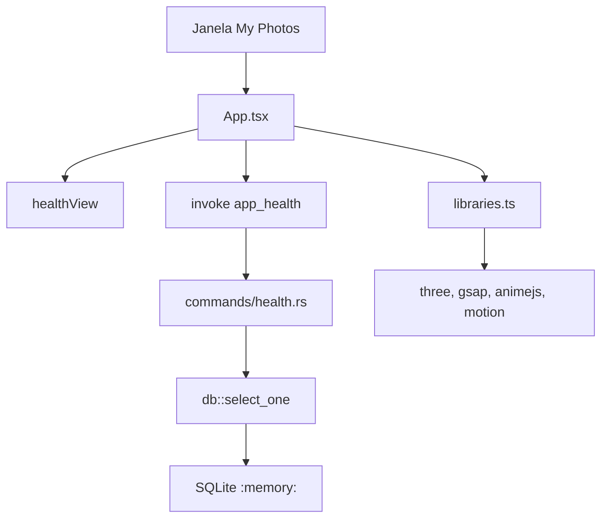

# F01 Project Setup Design

**Spec**: `.specs/features/f01-project-setup/spec.md`
**Status**: Approved

A spec confirmada já trava a única arquitetura no escopo (AD-002): Tauri 2, React, TypeScript, Vite, `rusqlite` bundled. Electron e `sqlx` ficam de fora. O stakeholder pediu execução em 2026-09-27.

AD-007 (`E:\` como pasta da biblioteca) não entra neste desenho. Nenhum módulo recebe esse caminho.

---

## Architecture Overview

O template oficial `react-ts` do `create-tauri-app` cria o processo desktop. Um comando `app_health` abre SQLite em memória, executa `SELECT 1` e devolve o payload da spec. O React só decide quais textos mostrar. As quatro bibliotecas de movimento são importadas num módulo que não cria renderer nem chama animação.



---

## Code Reuse Analysis

### Existing Components to Leverage

| Component | Location | How to Use |
| --------- | -------- | ---------- |
| Nenhum código de app | — | O repositório só tem `.specs/` e README. O scaffold nasce do template oficial Tauri, não de código local |

### Integration Points

| System | Integration Method |
| ------ | ------------------ |
| Tauri IPC | `#[tauri::command] app_health` registrado em `invoke_handler`, liberado na capability da janela `main` |
| SQLite | `rusqlite` 0.40.2, feature `bundled`, `Connection::open_in_memory` + `query_row("SELECT 1")` |
| CI | GitHub Actions chama os mesmos comandos locais: `npm run build`, `node --experimental-strip-types --test`, `cargo test` |

O `node --test` cobre textos e arquivos cuja spec define o resultado exato. O workflow também roda esse comando. A spec exige `npm run build` e `cargo test`; o teste Node é adicional e não substitui nenhum dos dois. A janela não abre no CI.

---

## Components

### Memory database

- **Purpose**: Abrir SQLite em memória e devolver o valor de `SELECT 1`.
- **Location**: `src-tauri/src/db.rs`
- **Interfaces**:
  - `select_one() -> Result<i64, String>` — abre `:memory:`, executa `SELECT 1`, devolve `1` ou o erro do `rusqlite` em `String`
- **Dependencies**: `rusqlite` com `bundled`
- **Reuses**: `Connection::open_in_memory` e `query_row` documentados em docs.rs

### Health mapping

- **Purpose**: Transformar o resultado do probe no payload da spec, ou em erro.
- **Location**: `src-tauri/src/commands/health.rs`
- **Interfaces**:
  - `health_from_probe(probe: Result<i64, String>) -> Result<AppHealth, String>`
  - `app_health() -> Result<AppHealth, String>` — chama `select_one` e passa o resultado a `health_from_probe`
- **Dependencies**: `db::select_one`, `serde::Serialize`
- **Reuses**: nenhum módulo local além de `db`

`AppHealth` é serializado com `rename_all = "camelCase"`:

```rust
pub struct AppHealth {
    pub app_name: String, // "My Photos"
    pub sqlite_ok: bool,  // true somente quando o probe devolve 1
}
```

Regras:

- `Ok(1)` → `Ok { app_name: "My Photos", sqlite_ok: true }`
- `Ok(n)` com `n != 1` → `Err("SELECT 1 retornou {n}")`
- `Err(message)` → `Err(message)` sem embrulhar de novo

### Tauri command bridge

- **Purpose**: Expor `app_health` ao frontend sem argumentos.
- **Location**: `src-tauri/src/lib.rs`, `src-tauri/permissions/app-health.toml`, `src-tauri/capabilities/default.json`
- **Interfaces**: comando Tauri `app_health` → `Result<AppHealth, String>`
- **Dependencies**: Tauri 2 ACL. Comando da aplicação só fica chamável se a capability da janela `main` incluir a permissão que o libera.
- **Reuses**: o `invoke_handler` gerado pelo template

Permissão:

```toml
[[permission]]
identifier = "allow-app-health"
description = "Enables the app_health command."
commands.allow = ["app_health"]
```

### Health view

- **Purpose**: Decidir os textos da janela a partir do payload ou de um erro de invoke.
- **Location**: `src/health/view.ts`
- **Interfaces**:
  - `healthView(health: { appName: string; sqliteOk: boolean } | null, errorMessage: string | null) -> HealthScreen`
- **Dependencies**: nenhuma biblioteca de UI
- **Reuses**: nenhum

`HealthScreen` tem `ready`, `sqlite`, `libraries` e `failure`, cada um `string | null`.

- Sucesso com `appName === "My Photos"` e `sqliteOk === true`: `ready = "My Photos está pronto."`, `sqlite = "SQLite: ok"`, `libraries = "three, gsap, animejs, motion"`, `failure = null`
- `sqliteOk !== true`, sem erro de invoke: só `failure = "Falha: sqliteOk inválido"`
- `errorMessage` não nulo: só `failure = "Falha: " + errorMessage`, e os outros campos nulos

### Motion link

- **Purpose**: Importar as quatro bibliotecas para o build falhar se alguma sumir, sem renderizar nem animar.
- **Location**: `src/motion/libraries.ts`
- **Interfaces**:
  - `linkedMotionLibraries(): "three, gsap, animejs, motion"`
- **Dependencies**: `three` (`REVISION`), `gsap` (`gsap`), `animejs` (`animate`), `motion/react` (`motion`)
- **Reuses**: a constante de linha definida em `view.ts`

A função lê os exports só para segurar o import. Não chama `animate`, não chama `gsap.to` e não instancia `WebGLRenderer`.

### Proof shell

- **Purpose**: Chamar `app_health` ao carregar e pintar o `HealthScreen`.
- **Location**: `src/App.tsx`
- **Interfaces**: componente React sem props
- **Dependencies**: `@tauri-apps/api/core` `invoke`, `healthView`, `linkedMotionLibraries`
- **Reuses**: o entry `src/main.tsx` do template

Antes do invoke, `linkedMotionLibraries()` roda. Se lançar, a tela mostra `Falha: ` mais a mensagem. No sucesso, a função só devolve a linha da spec; os três textos de sucesso vêm de `healthView`.

### CI

- **Purpose**: Rodar build, teste Node e `cargo test` sem abrir a janela.
- **Location**: `.github/workflows/ci.yml`
- **Interfaces**: workflow `push` e `pull_request` em `windows-latest` (AD-003)
- **Dependencies**: Node.js Active LTS e Rust stable no runner
- **Reuses**: nenhum workflow existente

---

## Data Models

### AppHealth

```typescript
interface AppHealth {
  appName: "My Photos"
  sqliteOk: true
}
```

No erro, não há body. O invoke rejeita com a `String` devolvida pelo Rust.

### HealthScreen

```typescript
interface HealthScreen {
  ready: string | null
  sqlite: string | null
  libraries: string | null
  failure: string | null
}
```

Não há tabelas nem arquivo `.db`.

---

## Error Handling Strategy

| Error Scenario | Handling | User Impact |
| -------------- | -------- | ----------- |
| `open_in_memory` ou `SELECT 1` falha | `app_health` devolve `Err` com a mensagem do `rusqlite` | A janela mostra `Falha: ` mais essa mensagem |
| `SELECT 1` devolve um inteiro diferente de `1` | `Err("SELECT 1 retornou {n}")` | Mesmo prefixo `Falha: ` |
| Resultado de sucesso com `sqliteOk !== true` | A view ignora os textos de sucesso | Texto exato `Falha: sqliteOk inválido` |
| Pacote de movimento ausente | `npm run build` falha no TypeScript | Sem janela de sucesso |
| WebView2 ausente | O runtime do Tauri falha ao abrir a janela | F01 não instala WebView2 |
| Capability sem `allow-app-health` | O invoke rejeita com erro de permissão | A janela mostra `Falha: ` mais a mensagem. O design inclui a permissão para esse caminho não acontecer |

---

## Risks & Concerns

| Concern | Location (file:line) | Impact | Mitigation |
| ------- | -------------------- | ------ | ---------- |
| Não há código nem testes no repositório | repo raiz | Não há padrão local para copiar | O template Tauri é a base; os testes nascem dos ACs da spec |
| Rust e o linker MSVC não estão no PATH desta máquina | ambiente local | `cargo test` não roda até o toolchain existir | Instalar Rust stable e as Build Tools C++ antes do gate. Sem isso a tarefa não é marcada pronta |
| Comando Tauri 2 negado sem permissão explícita | `src-tauri/capabilities` | A janela mostraria `Falha:` mesmo com SQLite ok | Permissão `allow-app-health` na capability da janela `main` |
| Importar `three` / `motion/react` num teste Node pode exigir DOM | teste de frontend | Teste frágil ou lento | O teste Node importa só `view.ts`. O vínculo das quatro libs fica no `npm run build` |
| `E:\` é um disco real com a biblioteca do usuário | AD-007 | Uma varredura acidental viola o escopo e o princípio de não destrutividade | Nenhum caminho desta feature aponta para `E:\` |

---

## Tech Decisions

| Decision | Choice | Rationale |
| -------- | ------ | --------- |
| Versão do `rusqlite` | 0.40.2, feature `bundled` | Última publicação verificada em crates.io (2026-08-08). `open_in_memory` é a API atual |
| Mapeamento do probe | Função pura `health_from_probe` | O erro de `SELECT 1` diferente de 1 e o erro de abertura ficam testáveis sem a janela |
| Teste dos textos | `node --experimental-strip-types --test` em `src/health/view.test.ts` | Node 22.19 já está instalado. Sem dependência nova. Não abre WebView |
| Janela | Título `My Photos` em `app.windows[].title` | No Tauri 2 o título da janela é esse campo, não só `productName` |
| CI | `windows-latest` | AD-003. O runner não executa `tauri dev` |
| Pasta `E:\` | Ignorada na F01 | AD-007. Escopo de F05/F16 |
