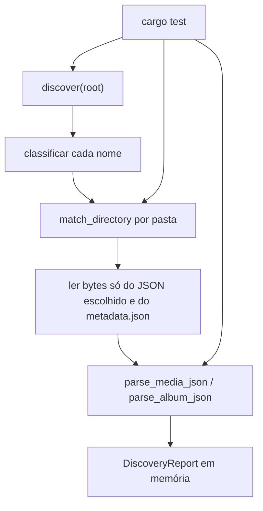

# F02 Takeout Discovery Design

**Spec**: `.specs/features/f02-takeout-discovery/spec.md`
**Status**: Approved

O stakeholder confirmou, em 2026-09-28, a abordagem de três funções puras compostas por uma descoberta. As alternativas (módulo único, comando Tauri) ficam de fora.

AD-002 coloca a lógica no Rust. AD-004 proíbe escrever na árvore lida. AD-007 (`E:\`) não entra: nenhum caminho padrão aponta para esse disco. Não há `context.md`.

Nenhuma decisão daqui vira convenção de projeto. Onde F06 e F08 vão reaproveitar essas funções fica registrado na tabela de decisões técnicas, no escopo desta feature.

---

## Architecture Overview

`discover` lê a árvore uma vez, agrupa os nomes por pasta e delega. A classificação e o matcher não abrem arquivo. O parser só recebe bytes. O comando `app_health` e o frontend não mudam.



---

## Code Reuse Analysis

### Existing Components to Leverage

| Component | Location | How to Use |
| --------- | -------- | ---------- |
| Crate `my_photos_lib` | `src-tauri/src/lib.rs` | Declarar `mod takeout`. Não registrar comando em `invoke_handler` |
| `serde_json` | `src-tauri/Cargo.toml` | Já é dependência. Parse via `serde_json::Value`, sem crate novo |
| Padrão de módulo | `src-tauri/src/db/mod.rs`, `src-tauri/src/commands/` | Pasta `takeout/` com submódulos e teste no próprio módulo |

Não há parser, matcher nem fixture para estender.

### Integration Points

| System | Integration Method |
| ------ | ------------------ |
| Sistema de arquivos | `std::fs::read_dir` e `std::fs::read` atrás de uma função injetável nos testes |
| Tauri / React / SQLite | Nenhum. `app_health` permanece o único comando |
| CI da F01 | O workflow já roda `cargo test`. Os testes novos entram por aí, sem job novo |

---

## Components

### Classificação

- **Purpose**: Decidir o papel de um nome de arquivo, sem olhar o conteúdo nem o disco.
- **Location**: `src-tauri/src/takeout/classify.rs`
- **Interfaces**:
  - `classify(file_name: &str) -> FileRole`
- **Dependencies**: nenhuma
- **Reuses**: nenhuma

`FileRole` é `Media { extension }` (extensão em minúsculas, sem ponto), `AlbumMetadata`, `JsonSidecar` ou `Ignored`.

Ordem fixa, comparação ASCII sem considerar maiúsculas:

1. `archive_browser.html` → `Ignored`
2. `metadata.json` → `AlbumMetadata`
3. extensão na lista da spec → `Media`
4. nome termina em `.json` → `JsonSidecar`
5. o resto → `Ignored`

Diretório não passa por `classify`. A extensão é o trecho depois do último `.`. Sem ponto, não é mídia.

### Matcher

- **Purpose**: Aplicar a cascata da spec a uma única pasta, só com nomes.
- **Location**: `src-tauri/src/takeout/matching.rs`
- **Interfaces**:
  - `truncate_sidecar_name(full: &str) -> Option<String>` — regra dos 51 bytes UTF-8. `None` se o corte de 46 bytes parte um caractere
  - `match_directory(names: &[String]) -> Vec<NameMatch>`
- **Dependencies**: `classify` para separar mídia, sidecar e álbum
- **Reuses**: `eq_ignore_ascii_case` da biblioteca padrão

`NameMatch` guarda o nome da mídia, a confiança (`Exact`, `Heuristic` ou `None`), o nome do JSON escolhido e, quando a spec pede, o motivo `Ambiguous`.

Candidatos são os `JsonSidecar` da mesma lista. `AlbumMetadata` nunca é candidato. Cada mídia enxerga a lista inteira. Um passo com dois arquivos distintos empata e a mídia fica `Ambiguous`. Dois nomes lógicos que truncam para o mesmo arquivo são um candidato só.

Passos, parando no primeiro com um único candidato:

1. `Exact`: `{arquivo}.json` ou `{stem}.json`, sem truncar. `{arquivo}` é o nome completo da mídia. Os dois existentes juntos empatam.
2. `Exact` para `{arquivo}.supplemental-metadata.json` e `{stem}.supplemental-metadata.json` com o nome inteiro; senão `Heuristic` para o truncamento deles (F08).
3. `Heuristic`: truncamento de `{arquivo}.json` e de `{stem}.json`, só se o passo 1 não achou o nome inteiro.
4. `Heuristic`: o stem termina em `(N)`, com `N` casando `\(([1-9][0-9]*)\)$` no fim. `base` é o stem sem esse sufixo. Os sidecars esperados são o truncamento de `base{ext}.json` e de `base{ext}.supplemental-metadata.json`, tirando o `.json` final e acrescentando `(N).json`. O resultado pode passar de 51 bytes. `(0)` e `(01)` não são marcador.
5. Só para stem que termina em `-edited` (ASCII, sem considerar maiúsculas). Roda depois dos passos 1–4 das outras mídias e depois do desempate entre elas. Repete os passos 1–4 com o nome `{stem-sem-edited}{ext}`. Só aceita o JSON se a mídia original está na mesma lista e ficou com esse JSON. A confiança do editado é sempre `Heuristic`. Se o original ficou `None` ou `Ambiguous`, o editado fica `None` sem motivo `Ambiguous`.

Desempate depois dos passos 1–4: se duas mídias que não formam o par `{nome}{ext}` / `{nome}-edited{ext}` ficaram com o mesmo JSON, as duas passam a `None` + `Ambiguous`, e o editado que só compartilhava esse JSON fica `None` sem motivo.

O matcher não lê JSON e não sabe o que há na pasta pai.

### Parser

- **Purpose**: Normalizar os campos da seção 9.2 e do `metadata.json` da seção 9.3.
- **Location**: `src-tauri/src/takeout/parse.rs`
- **Interfaces**:
  - `parse_media_json(bytes: &[u8]) -> Result<MediaMetadata, ()>`
  - `parse_album_json(bytes: &[u8]) -> Result<AlbumMetadata, ()>`
- **Dependencies**: `serde_json::Value`
- **Reuses**: nenhuma função local

`Err(())` só quando os bytes não são um valor JSON. Campo ausente, vazio ou de tipo errado vira `None` (ou some da lista) e o resto do valor permanece. Chaves desconhecidas são ignoradas. Não há `Deserialize` rígido do documento inteiro: isso falharia o arquivo quando um campo viesse com tipo inesperado, e a spec proíbe isso.

Timestamp: string decimal com `-` opcional, ou inteiro JSON. Vira `i64`. Float, string vazia e texto não numérico deixam o campo ausente.

Local: `geoData` primeiro. Latitude e longitude presentes e ambas `0.0` (incluindo zero negativo) tornam o local ausente, altitude inclusive. Senão, as duas coordenadas entram e a altitude só se for número. `geoData` sem local cai para `geoDataExif` com a mesma regra. Uma coordenada só, sem o par, é local ausente.

`people[].name`: strings não vazias, na ordem do array. Item que não é objeto ou nome que não é string some da lista. `people` ausente produz lista vazia.

`title`, `description` e `url`: só `String` com tamanho maior que zero, sem cortar espaços. O parser não abre `url`.

Álbum: `title`, `description`, `date.timestamp` → `date_unix`, e o mesmo local em `geoData`. Sem `geoDataExif` no álbum.

### Descoberta

- **Purpose**: Percorrer a árvore, juntar matcher e parser, devolver o relatório sem escrever nada.
- **Location**: `src-tauri/src/takeout/mod.rs`
- **Interfaces**:
  - `discover(root: &Path) -> Result<DiscoveryReport, String>` — lê do disco. `Err` só quando `root` não é um diretório legível
  - `discover_with(root: &Path, read_json: impl Fn(&Path) -> Result<Vec<u8>, String>) -> Result<DiscoveryReport, String>` — `pub(crate)`. A política de `unreadable` é testada com uma leitura que falha, sem depender de trava do Windows
- **Dependencies**: `classify`, `matching`, `parse`, `std::fs`
- **Reuses**: o padrão de módulo do crate. Não usa `db` nem `commands`

A caminhada usa `read_dir` e o tipo do symlink sem seguir o alvo. Symlink de arquivo é ignorado. Symlink de diretório não é recursivo. Isso impede a fixture de sair da raiz por um link. F05 decide o que fazer com junction do disco de verdade.

Caminhos do relatório são relativos à raiz, com `/`, nunca `\`. A ordenação lexicográfica é a desse texto, com o nome que o diretório devolveu, sem rebaixar maiúsculas.

Por pasta, `match_directory` roda nos nomes daquela pasta. Bytes só são lidos para o JSON associado a pelo menos uma mídia e para cada `metadata.json`. Órfão não é lido: vira problema `OrphanJson` mesmo se o conteúdo for lixo. JSON associado que não é valor JSON vira `InvalidJson`, e a mídia que o apontava fica `None` sem motivo `Ambiguous`. Falha de leitura desses arquivos vira `Unreadable` e a mídia associada fica `None`. Um álbum só entra no relatório quando o `metadata.json` parseia. Pasta `Photos from …` sem esse arquivo não gera álbum.

As três listas do relatório (`media`, `albums`, `problems`) saem ordenadas pelo caminho relativo. Duas chamadas na mesma árvore devolvem o mesmo valor. A função não cria, não renomeia, não apaga e não abre arquivo para escrita.

`lib.rs` ganha `mod takeout;` e nada mais.

---

## Data Models

Definidos em `src-tauri/src/takeout/model.rs`. Sem `Serialize`: a F02 não cruza o IPC.

```rust
pub enum Confidence { Exact, Heuristic, None }

pub enum UnmatchedReason { Ambiguous }

pub struct MediaMetadata {
    pub taken_at_unix: Option<i64>,
    pub creation_time_unix: Option<i64>,
    pub latitude: Option<f64>,
    pub longitude: Option<f64>,
    pub altitude: Option<f64>,
    pub people: Vec<String>,
    pub title: Option<String>,
    pub description: Option<String>,
    pub url: Option<String>,
}

pub struct MediaHit {
    pub relative_path: String,
    pub confidence: Confidence,
    pub json_relative_path: Option<String>,
    pub metadata: Option<MediaMetadata>,
    pub reason: Option<UnmatchedReason>,
}

pub struct AlbumMetadata {
    pub title: Option<String>,
    pub description: Option<String>,
    pub date_unix: Option<i64>,
    pub latitude: Option<f64>,
    pub longitude: Option<f64>,
    pub altitude: Option<f64>,
}

pub struct AlbumHit {
    pub relative_path: String,
    pub metadata: AlbumMetadata,
}

pub enum ProblemKind { InvalidJson, Unreadable, OrphanJson }

pub struct Problem {
    pub relative_path: String,
    pub kind: ProblemKind,
}

pub struct DiscoveryReport {
    pub media: Vec<MediaHit>,
    pub albums: Vec<AlbumHit>,
    pub problems: Vec<Problem>,
}
```

**Relacionamentos**: `MediaHit.json_relative_path` aponta para um sidecar na mesma pasta. O par original / `-edited` pode compartilhar esse caminho e o mesmo `MediaMetadata` (cópia própria em cada hit). `AlbumHit.relative_path` é o `metadata.json`. `Problem` não aponta para mídia.

`reason: Some(Ambiguous)` só ocorre com `confidence: None` e sem JSON. `None` por falta de sidecar deixa `reason` vazio. Mídia e problema não duplicam o motivo `InvalidJson`: o problema carrega o caminho do JSON, a mídia fica `None`.

Fixtures em `src-tauri/fixtures/takeout/`, uma pasta por critério que precisa de disco. Arquivos de mídia vazios. JSON pequeno, commitado. Testes de parser e de matcher que só precisam de nomes ou bytes não usam disco. O teste de não destrutividade compara o conjunto de caminhos, tamanhos e bytes da fixture antes e depois de `discover`.

---

## Error Handling Strategy

| Error Scenario | Handling | User Impact |
| -------------- | -------- | ----------- |
| `root` ausente ou não é diretório | `discover` devolve `Err(String)` | Nenhum. Não há UI nesta feature |
| JSON associado ou `metadata.json` com bytes que não são JSON | Problema `InvalidJson`. Mídia fica `None`. Demais itens seguem | Nenhum |
| Leitura falha no JSON que seria lido | Problema `Unreadable`. Mídia associada fica `None`. Demais itens seguem | Nenhum |
| JSON sem mídia | Problema `OrphanJson`, sem leitura | Nenhum |
| Empate na cascata | Mídias `None` + `Ambiguous`. JSON vira `OrphanJson` | Nenhum |
| Campo de tipo inesperado | Campo ausente. Arquivo continua válido | Nenhum |
| Symlink | Ignorado, sem seguir o alvo | Nenhum |

Não há log, telemetria nem rede.

---

## Risks & Concerns

| Concern | Location (file:line) | Impact | Mitigation |
| ------- | -------------------- | ------ | ---------- |
| Não há teste de Takeout no crate. O único teste de disco é o de `select_one`, que olha `*.db` no diretório de trabalho | `src-tauri/src/db/mod.rs:36` | Um matcher sem teste de nome passa no CI e erra no Takeout real | Testes novos em `takeout/`, cobrindo os 27 critérios. O teste de `db` não é reaproveitado como oráculo |
| `std::fs::File` no Windows abre com compartilhamento. Um segundo `read` num arquivo aberto pelo teste não vira erro | biblioteca padrão, não há chamada no repo | O critério de `unreadable` ficaria sem teste, ou o teste passaria à toa | `discover_with` recebe a função de leitura. O teste devolve erro num caminho. `discover` público usa `std::fs::read` |
| Seguir symlink de diretório deixa a descoberta sair da fixture | ainda não existe walker | Pode ler `E:\` ou um ciclo | `file_type` sem seguir. Symlink não entra no relatório |
| Ler o JSON inteiro sem limite | ainda não existe leitura | Um sidecar enorme segura memória. A spec não define teto | F02 lê o arquivo todo porque as fixtures são pequenas. O teto fica para F06/F36, sem cortar JSON válido nesta feature |
| O matcher compara nomes dentro da pasta. Pasta de dezenas de milhares de arquivos fica quadrática | ainda não existe | Irrelevante nas fixtures. F08 herdaria o custo se copiar o laço cegamente | O escopo é por pasta e só com nomes. F08 mede o custo; esta feature não indexa a biblioteca |
| `Deserialize` de struct rejeita o documento quando um campo vem com tipo errado | `serde_json` já está no `Cargo.toml:24` | Violaria TD-18 e TD-23: um campo ruim derrubaria o JSON inteiro | Extração manual a partir de `Value` |

---

## Tech Decisions

| Decision | Choice | Rationale |
| -------- | ------ | --------- |
| Onde o código mora | `src-tauri/src/takeout/`, funções públicas do crate, sem comando Tauri | Abordagem confirmada. F06 e F08 importam daqui em vez de abrir outro crate |
| Corte de dependência dos testes | Matcher e parser puros. Disco só na descoberta | Os critérios de nome e de campo não precisam de fixture |
| Leitura injetável | `discover_with` é `pub(crate)` | Testa `unreadable` sem ACL do Windows |
| Separador dos caminhos no relatório | `/` | A ordem lexicográfica da spec tem de ser a mesma no Windows |
| JSON flexível | `serde_json::Value` e campos lidos à mão | Tipo ruim num campo não invalida o arquivo |
| Symlink | Não seguir | Mantém a descoberta dentro da raiz. F05 revê junction de volume |
| Marcador `(N)` | Só `\(([1-9][0-9]*)\)$` no fim do stem | A spec pede inteiro positivo. `(0)` e `(01)` não entram |
| Serialização do relatório | Nenhuma nesta feature | Não há IPC. Teste compara campos |
