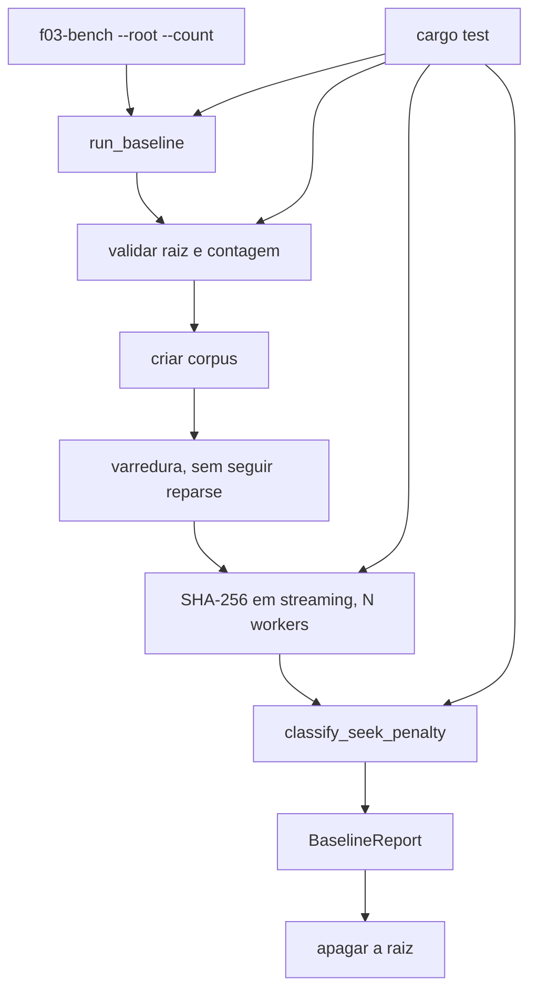

# F03 Performance Baseline Design

**Spec**: `.specs/features/f03-performance-baseline/spec.md`
**Status**: Approved

O stakeholder confirmou, em 2026-09-28, a abordagem de módulo Rust no crate mais um binário fino. As alternativas (só `cargo test --ignored`, script PowerShell, comando Tauri) ficam de fora.

AD-002 coloca a medição no Rust. AD-003 limita a consulta de disco ao Windows; fora dele a classe é `unknown`. AD-004 e AD-007 proíbem usar a biblioteca real: o binário não tem diretório padrão e nunca aponta para `E:\`. Não há `context.md`.

Nenhuma decisão daqui vira convenção de projeto. A F11 identifica volume por serial, não por penalidade de seek. Pode reaproveitar a consulta mais tarde; isso não fica obrigatório para ela.

---

## Architecture Overview

A função pública cria o corpus, mede a varredura, mede o hash e apaga a raiz. O SHA-256, o caminho de cada índice e `classify_seek_penalty` são funções puras. O teste de arquivo ilegível injeta a abertura, no mesmo espírito de `discover_with`. O binário `f03-bench` só lê argumentos, chama a função pública e imprime o JSON. `app_health` e o frontend não mudam.



---

## Code Reuse Analysis

### Existing Components to Leverage

| Component | Location | How to Use |
| --------- | -------- | ---------- |
| Crate `my_photos_lib` | `src-tauri/src/lib.rs` | Declarar `pub mod bench`. Não registrar comando em `invoke_handler` |
| `serde` com `derive` | `src-tauri/Cargo.toml` | `Serialize` do relatório, `rename_all = "camelCase"` |
| Leitura injetável | `src-tauri/src/takeout/mod.rs` | O mesmo corte: função pública lê do disco; função `pub(crate)` recebe a abertura |
| CI | `.github/workflows/ci.yml` | Já executa `cargo test --manifest-path src-tauri/Cargo.toml`. Nenhum job novo. Esse teste não cria o corpus de 50.000 nem o de 150.000 |

Não há walker, hash nem classificador de volume para estender.

### Integration Points

| System | Integration Method |
| ------ | ------------------ |
| Sistema de arquivos | `std::fs` para criar, listar e apagar. Hash lê com buffer de 65.536 bytes |
| Volume Windows | `windows-sys` 0.61.2: `CreateFileW` em `\\.\X:` e `DeviceIoControl` com `IOCTL_STORAGE_QUERY_PROPERTY` |
| SHA-256 | Crate `sha2` 0.11.0, `Sha256` e o trait `Digest`. API incremental documentada em docs.rs para 0.11.0 |
| Tauri / React / SQLite | Nenhum |

---

## Components

### Modelo

- **Purpose**: Tipos do relatório e os códigos de erro estáveis da spec.
- **Location**: `src-tauri/src/bench/model.rs`
- **Interfaces**: structs e enums abaixo, sem método de I/O
- **Dependencies**: `serde::Serialize`
- **Reuses**: o `serde` já declarado na F01

`BenchError` expõe `as_code() -> &'static str` com os textos `count_out_of_range`, `root_not_absolute`, `root_is_volume`, `parent_missing`, `root_not_empty`, `setup_failed` e `cleanup_failed`. O erro do binário ao gravar `--output` é `output_failed` e não entra nesse enum: a medição já terminou.

### Corpus

- **Purpose**: Calcular bytes, caminho e validar a raiz sem medir tempo.
- **Location**: `src-tauri/src/bench/corpus.rs`
- **Interfaces**:
  - `file_bytes(index: u32) -> [u8; 4096]` — byte `j` é `(index + j) % 251`
  - `relative_path(index: u32) -> String` — `f03/{ano}/{mês}/{arquivo}` com `/`, ano e mês pela regra da spec, arquivo `item-{índice:07}.bin`
  - `validate(root: &Path, item_count: u32) -> Result<(), BenchError>` — os cinco erros de pré-condição, sem criar nem apagar
- **Dependencies**: `std::path`, `std::fs` só para existir o pai e a raiz não estar vazia
- **Reuses**: nenhuma função do `takeout`

Caminho com prefixo que não seja disco (`Prefix::Disk` ou `Prefix::VerbatimDisk`) devolve `root_not_absolute`. Isso cobre relativo e UNC. Componente `.` ou `..` também devolve `root_not_absolute`, para a chamada não resolver para fora do diretório indicado. Barra final é descartada antes da checagem, exceto quando o resultado é a raiz do volume. Raiz de volume (`C:\`, `C:`, `\\?\C:\`) devolve `root_is_volume`. `parent_missing` quando o pai não existe. `root_not_empty` quando `read_dir` devolve ao menos uma entrada. Tudo isso ocorre antes do primeiro `create_dir`.

### Hash

- **Purpose**: SHA-256 de um leitor em streaming e o digest agregado na ordem do índice.
- **Location**: `src-tauri/src/bench/hash.rs`
- **Interfaces**:
  - `hash_reader(reader: impl Read) -> io::Result<[u8; 32]>` — blocos de no máximo 65.536 bytes
  - `content_digest(digests_in_order: &[Option<[u8; 32]>]) -> String` — concatena só os `Some`, na ordem do slice. Slice vazio ou só `None` devolve string vazia. Hex minúsculo de 64 caracteres
- **Dependencies**: `sha2` 0.11.0
- **Reuses**: nenhuma função local

O vetor da spec é testado com `Sha256::digest` dos bytes de `file_bytes(0)`, `file_bytes(1)` e `file_bytes(63)`, e com `content_digest` dos 64 arquivos.

### Volume

- **Purpose**: Mapear a penalidade de seek para `hdd`, `ssd` ou `unknown`, e consultar o Windows.
- **Location**: `src-tauri/src/bench/volume.rs`
- **Interfaces**:
  - `classify_seek_penalty(incurs: Option<bool>) -> VolumeClass`
  - `query_seek_penalty(volume_root: &str) -> Option<bool>` — `None` quando a abertura ou o `DeviceIoControl` falha. Fora do Windows devolve `None` sem chamar API
  - `volume_root_of(root: &Path) -> String` — letra maiúscula e `:\`, por exemplo `D:\`. Fora do Windows, string vazia
- **Dependencies**: `windows-sys` 0.61.2 apenas em `cfg(windows)`
- **Reuses**: `classify_seek_penalty` é a função pura da spec

Features do `windows-sys`, só no alvo Windows: `Win32_Foundation`, `Win32_Storage_FileSystem`, `Win32_System_IO`, `Win32_System_Ioctl`. A consulta abre `\\.\X:` com acesso desejado 0, compartilhamento de leitura e escrita, `OPEN_EXISTING`. O pedido usa `STORAGE_PROPERTY_QUERY` com `StorageDeviceSeekPenaltyProperty` (valor 7) e `PropertyStandardQuery`. A saída é `DEVICE_SEEK_PENALTY_DESCRIPTOR`. `IncursSeekPenalty` vira `Some(true)` ou `Some(false)`. Qualquer falha vira `None`, e a medição segue com `unknown`.

### Baseline

- **Purpose**: Orquestrar validação, criação, varredura, hash, relatório e limpeza.
- **Location**: `src-tauri/src/bench/mod.rs`
- **Interfaces**:
  - `run_baseline(root: &Path, item_count: u32) -> Result<BaselineReport, BenchError>`
  - `run_baseline_with(root: &Path, item_count: u32, hooks: Hooks) -> Result<BaselineReport, BenchError>` — `pub(crate)`
- **Dependencies**: corpus, hash, volume, `std::thread`, `std::time::Instant`
- **Reuses**: o corte público/injetável do `takeout`

`Hooks` tem `open_for_hash: Option<fn(&Path) -> io::Result<Box<dyn Read + Send>>>`, `fail_setup_at: Option<u32>` e `fail_cleanup: bool`. `None` na abertura usa `File::open`. `fail_setup_at` devolve `setup_failed` depois de criar esse número de arquivos, para o teste não precisar encher o disco. `fail_cleanup` monta a medição, não apaga a raiz e devolve `cleanup_failed`.

Ordem fixa:

1. `validate`. Erro aqui não toca o disco.
2. Criar a raiz com `create_dir` se ela não existe. Lembrar se a chamada a criou.
3. Escrever os arquivos na ordem do índice. Falha ou `fail_setup_at`: apagar o que foi criado sob a raiz; se a chamada criou a raiz, apagá-la também. Devolver `setup_failed`. Não há relatório.
4. `walkElapsedMs`: uma passagem com `read_dir`. Diretório com `FILE_ATTRIBUTE_REPARSE_POINT` (0x400), lido via `symlink_metadata`, não é descido. Fora do Windows, `file_type().is_symlink()` também não é descido. Arquivo regular entra na lista. O relógio não inclui a criação nem o hash.
5. `hashElapsedMs`: workers em `thread::scope`. A quantidade de threads não passa de `workerCount` nem da quantidade de arquivos. `workerCount` gravado no relatório é `available_parallelism`, ou 1 se a chamada falhar — o número do processo, mesmo quando há menos arquivos do que workers. Cada worker só lê o próprio arquivo, em streaming. Falha de abertura entra em `failures` com `reason` `unreadable` e o `relativePath` com `/`. O arquivo não entra no digest. Os demais seguem.
6. Montar o relatório. `ok` é true só com `failureCount == 0` e `filesHashed == itemCount`. Arquivo regular extra, se aparecer, conta em `filesHashed` e deixa `ok` false; o digest só concatena índices conhecidos, em ordem crescente.
7. Apagar a raiz inteira com `remove_dir_all`, inclusive se `ok` é false. Se a remoção falha, devolver `cleanup_failed` sem tratar o relatório como evidência.

`lib.rs` ganha `pub mod bench;` e nada mais no `invoke_handler`.

### Binário

- **Purpose**: Deixar o operador gravar o JSON de 50.000 e de 150.000 sem abrir a janela do Tauri.
- **Location**: `src-tauri/src/bin/f03-bench.rs`
- **Interfaces**: `f03-bench --root <abs> --count <n> [--output <arquivo>]`
- **Dependencies**: `my_photos_lib::bench::run_baseline`, `serde_json`
- **Reuses**: a função pública. Não copia `windows_subsystem = "windows"` de `src-tauri/src/main.rs`

Não há valor padrão para `--root` nem para `--count`. Argumento ausente: stderr `usage`, saída 2, sem criar arquivo. `Err` da função: stderr com o `as_code()`, saída 1. `Ok`: JSON pretty em stdout; se `--output` foi passado, o mesmo texto nesse arquivo. Saída 0 mesmo quando `report.ok` é false, porque o JSON ainda é o resultado. Falha ao gravar `--output`: stderr `output_failed`, saída 1, depois da limpeza do corpus. O processo é de console. O atributo de subsistema gráfico do `main.rs` não se aplica a este binário.

Comando a partir da raiz do repositório:

```text
cargo run --manifest-path src-tauri/Cargo.toml --bin f03-bench -- --root <pasta-vazia> --count 50000 --output .specs/features/f03-performance-baseline/baselines/ssd-50000.json
```

O nome do arquivo é `{volumeClass}-{itemCount}.json`, conforme a spec. A classe só é conhecida depois da corrida; o operador usa o `volumeClass` impresso. Meio ausente na máquina não gera arquivo e é declarado num `baselines/README.md` curto (`hdd` ou `ssd` não medido). O CI não executa este binário.

---

## Data Models

Definidos em `src-tauri/src/bench/model.rs`. `BaselineReport`, `HashFailure` e `VolumeClass` derivam `Serialize`.

```rust
pub enum VolumeClass { Hdd, Ssd, Unknown }

pub struct HashFailure {
    pub relative_path: String,
    pub reason: String, // sempre "unreadable"
}

pub struct BaselineReport {
    pub item_count: u32,
    pub bytes_per_item: u32, // 4096
    pub volume_class: VolumeClass,
    pub volume_root: String,
    pub worker_count: u32,
    pub files_hashed: u32,
    pub total_bytes: u64,
    pub failure_count: u32,
    pub failures: Vec<HashFailure>,
    pub content_digest: String,
    pub walk_elapsed_ms: u64,
    pub hash_elapsed_ms: u64,
    pub ok: bool,
}
```

**Relacionamentos**: não há entidade de banco. `failures[].relative_path` é um caminho da árvore medida. O JSON usa camelCase (`itemCount`, `bytesPerItem`, `volumeClass`, `volumeRoot`, `workerCount`, `filesHashed`, `totalBytes`, `failureCount`, `contentDigest`, `walkElapsedMs`, `hashElapsedMs`). `VolumeClass` serializa `hdd`, `ssd`, `unknown`.

---

## Error Handling Strategy

| Error Scenario | Handling | User Impact |
| -------------- | -------- | ----------- |
| Contagem fora de 1..=150000 | `count_out_of_range`, disco intacto | stderr do binário, saída 1 |
| Caminho relativo, UNC, `.` ou `..` | `root_not_absolute`, disco intacto | stderr, saída 1 |
| Raiz de volume | `root_is_volume`, disco intacto | stderr, saída 1 |
| Pai inexistente | `parent_missing`, disco intacto | stderr, saída 1 |
| Raiz com qualquer entrada | `root_not_empty`, nada é apagado | stderr, saída 1 |
| Falha no meio da criação | `setup_failed`; some só o que esta chamada criou | stderr, saída 1 |
| Arquivo ilegível no hash | Segue os outros; `ok` false; limpeza mesmo assim | JSON com `failures` |
| Consulta de volume falha | `volumeClass` `unknown`; a medição segue | JSON ainda sai |
| Limpeza não apaga a raiz | `cleanup_failed` | stderr, saída 1. Relatório não é evidência |
| `--output` não grava | `output_failed` depois da limpeza | stderr, saída 1 |
| Processo morto no meio | Lixo pode restar. A próxima chamada vê pasta não vazia e não apaga sozinha | Operador remove a pasta à mão |

Não há log, telemetria nem rede.

---

## Risks & Concerns

| Concern | Location (file:line) | Impact | Mitigation |
| ------- | -------------------- | ------ | ---------- |
| O teste de `select_one` só compara nomes `*.db` no diretório de trabalho | `src-tauri/src/db/mod.rs:36` | Usar esse teste como prova de não destrutividade não veria um arquivo escrito ao lado da pasta do benchmark | Os testes da F03 comparam um marcador fora da raiz e um arquivo dentro da pasta recusada, antes e depois. Não reutilizam `database_file_names` |
| `FileType::is_symlink` no Windows é falso para junção de diretório | `std` no alvo Windows; ainda não há walker no crate | A varredura desceria a junção e contaria arquivos fora da raiz, podendo alcançar `E:\` | A passagem usa `symlink_metadata` e `FILE_ATTRIBUTE_REPARSE_POINT`. Não desce. O teste cria uma junção com `mklink /J` para um diretório fora da raiz e confere que esse arquivo não entra no hash nem é apagado |
| `remove_dir_all` que seguisse ponto de reanálise apagaria o alvo da junção | mesmo cenário, ainda sem chamada | Apagaria o sentinela fora da raiz e, no pior caso, dado do usuário | A limpeza apaga a raiz da medição. O teste da junção exige que o sentinela fora dela continue lá depois do retorno |
| Abrir `\\.\X:` ou o IOCTL pode falhar sem privilégio, ou em volume virtual | ainda não há chamada | `volumeClass` errado se a gente tratasse falha como HDD | Falha vira `None` e `unknown`. A medição não aborta |
| Lista de 150.000 caminhos segura memória se cada arquivo também estiver em RAM | ainda não há função | 600 MiB de conteúdo além dos caminhos, à toa | O hash faz streaming com buffer de 65.536 bytes por worker. Só o caminho e os 32 bytes do digest ficam |
| `src-tauri/src/main.rs` marca o binário do app como subsistema Windows no release | `src-tauri/src/main.rs:2` | Se o benchmark fosse o mesmo `main`, o JSON não apareceria no console | O benchmark é `src/bin/f03-bench.rs`, sem esse atributo |
| Corpus de 50.000 arquivos no `cargo test` padrão estoura tempo do CI | `.github/workflows/ci.yml:21` | O job deixa de ser o teste de correção da F01/F02 | Só contagens pequenas no teste automático. 50.000 e 150.000 existem só pela execução do binário, fora do CI |

---

## Tech Decisions

| Decision | Choice | Rationale |
| -------- | ------ | --------- |
| Onde o código mora | `src-tauri/src/bench/`, público no crate, sem comando Tauri | Abordagem confirmada. F05 importa a medição em vez de abrir outro crate |
| SHA-256 | `sha2` 0.11.0 | Implementação RustCrypto do FIPS 180-4. `Sha256` e `Digest` conferidos em docs.rs 0.11.0. Não reimplementar o algoritmo |
| Consulta de disco | `windows-sys` 0.61.2, structs já exportadas (`STORAGE_PROPERTY_QUERY`, `DEVICE_SEEK_PENALTY_DESCRIPTOR`, constantes 2954240 e 7) | A spec pede `IncursSeekPenalty`. FFI manual repetiria o layout que a crate já declara |
| Paralelismo | `std::thread::scope` | Sem crate extra. O relatório guarda o paralelismo do processo |
| Arquivo ilegível e falha de criação | `run_baseline_with` é `pub(crate)` | O mesmo motivo da F02: no Windows o arquivo que acabamos de criar não fica ilegível para o próprio processo |
| `.` e `..` | `root_not_absolute` | A spec não cria um código novo. Um caminho não normalizado escreveria fora da pasta pedida |
| Formato do JSON | `serde_json` pretty, camelCase | O arquivo em `baselines/` precisa ser legível. Os nomes dos campos são os da spec |
| Evidência de 50k/150k | Binário, não teste `ignored` | `cargo test` no CI não pode gerar esses corpus. O README da pasta declara o meio que não existe |
