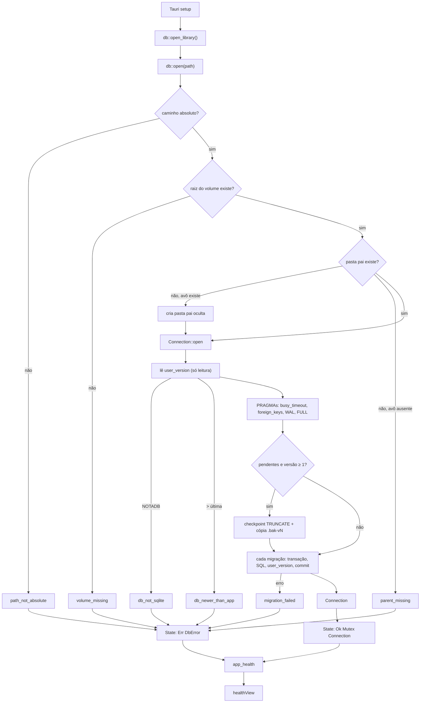

# F04 — Database Schema Design

**Spec**: `.specs/features/f04-database-schema/spec.md`
**Status**: Approved (stakeholder "prossiga", 2026-10-02)

---

## Architecture Overview

O processo do app abre o banco uma vez, no `setup` do Tauri, e guarda o resultado (conexão ou erro) no estado gerenciado. O comando `app_health` só lê esse estado. A abertura segue uma ordem fixa para nunca escrever num arquivo que não entende.



### Abordagens consideradas

| Abordagem | Prós | Contras |
| --------- | ---- | ------- |
| **A. Runner próprio com `PRAGMA user_version` + SQL embutido (`include_str!`)** — escolhida | Zero dependência nova; controle total da ordem "ler versão antes de qualquer escrita", da cópia `.bak` e dos códigos de erro do spec | ~80 linhas nossas para manter |
| B. Crate `rusqlite_migration` | Pronto, também usa `user_version` | Ainda precisaríamos envolver para `.bak`, `db_newer_than_app` e a ordem de leitura; versão casada com a do rusqlite |
| C. `refinery` | Popular, multi-banco | Tabela própria de histórico, mais peso que valor para um banco local |

---

## Code Reuse Analysis

### Existing Components to Leverage

| Component | Location | How to Use |
| --------- | -------- | ---------- |
| `rusqlite` (bundled, SQLite 3.53.2) | `src-tauri/Cargo.toml` | Conexão, PRAGMAs, transações. Generated columns e `strftime(..., 'Z')` disponíveis |
| `windows-sys` `Win32_Storage_FileSystem` | `src-tauri/Cargo.toml` | `SetFileAttributesW(FILE_ATTRIBUTE_HIDDEN)` na pasta `.myphotos` — feature já habilitada |
| Validação de caminho com letra de unidade | `src-tauri/src/bench/corpus.rs` (`is_drive_absolute`, `is_volume_root`) | Mesmo padrão de `Component::Prefix` + `RootDir`; reimplementado no `db` (são `cfg(windows)` privados do bench) |
| Erro com `as_code()` estável | `src-tauri/src/bench/model.rs` (`BenchError`) | `DbError` segue o mesmo formato: enum + `as_code()` + mensagem pt-BR |
| `health_from_probe` puro + teste | `src-tauri/src/commands/health.rs` | Vira `health_from_open(Result<u32, DbError>)`, continua puro e testável |
| `healthView` puro + `node --test` | `src/health/view.ts` | Troca a linha `SQLite: ok` por `Banco: esquema v{n}` |
| Scratch dir com `Drop` | `src-tauri/src/bench/mod.rs` (`Scratch`) | Mesmo padrão nos testes do banco: tudo em `%TEMP%`, nunca em `E:\` |

### Integration Points

| System | Integration Method |
| ------ | ------------------ |
| Tauri | `Builder::setup` abre o banco e chama `app.manage(DbState)`; `app_health` recebe `State<DbState>` |
| Frontend | `invoke("app_health")` devolve `{ appName, schemaVersion }` ou rejeita com a mensagem pt-BR |
| F02 (`takeout`) | Nenhuma nesta feature. Os caminhos que o F02 reporta (relativos, `/`) são o formato de `relative_path` |

---

## Components

### `db` — abertura e migração

- **Purpose**: Abrir ou criar o banco num caminho, aplicar migrações e devolver a conexão ou um `DbError` com código.
- **Location**: `src-tauri/src/db/mod.rs`, `src-tauri/src/db/migrations.rs`, `src-tauri/src/db/migrations/0001_initial.sql`
- **Interfaces**:
  - `pub const LIBRARY_DB_PATH: &str = r"E:\.myphotos\library.db"` — AD-007/AD-011
  - `pub fn open_library() -> Result<Connection, DbError>` — `open(Path::new(LIBRARY_DB_PATH))`
  - `pub fn open(path: &Path) -> Result<Connection, DbError>` — `open_with(path, MIGRATIONS)`
  - `pub(crate) fn open_with(path: &Path, migrations: &[Migration]) -> Result<Connection, DbError>` — injeta listas de teste (migração quebrada)
  - `pub(crate) struct Migration { pub version: u32, pub sql: &'static str }`
  - `pub(crate) const MIGRATIONS: &[Migration]` — hoje só `{ version: 1, sql: include_str!("migrations/0001_initial.sql") }`
  - `pub fn latest_version() -> u32`
- **Dependencies**: `rusqlite`, `windows-sys` (só para o atributo oculto)
- **Reuses**: padrões de `bench::corpus` e `bench::model`

### `DbError`

- **Location**: `src-tauri/src/db/mod.rs`
- **Interfaces**: `as_code(self) -> &'static str`, `message(self) -> &'static str`

| Variante | `as_code()` | `message()` |
| -------- | ----------- | ----------- |
| `PathNotAbsolute` | `path_not_absolute` | `caminho do banco não é absoluto` |
| `VolumeMissing` | `volume_missing` | `disco E: não encontrado` |
| `ParentMissing` | `parent_missing` | `pasta do banco não encontrada` |
| `OpenFailed` | `open_failed` | `não foi possível abrir o banco` |
| `NotSqlite` | `db_not_sqlite` | `o arquivo do banco não é um banco SQLite` |
| `NewerThanApp` | `db_newer_than_app` | `o banco é de uma versão mais nova do My Photos` |
| `BackupFailed` | `backup_failed` | `não foi possível copiar o banco antes de atualizar` |
| `MigrationFailed` | `migration_failed` | `falha ao atualizar o banco` |

`VolumeMissing` diz "disco E:" porque o único caminho de produção é `LIBRARY_DB_PATH`; os testes só comparam `as_code()`.

### `commands::health`

- **Purpose**: Expor o resultado da abertura à UI.
- **Location**: `src-tauri/src/commands/health.rs`
- **Interfaces**:
  - `pub struct AppHealth { app_name: String, schema_version: u32 }` (camelCase no JSON)
  - `pub fn health_from_open(result: Result<u32, DbError>) -> Result<AppHealth, String>` — `Err(error.message())`
  - `#[tauri::command] app_health(state: State<DbState>) -> Result<AppHealth, String>`
  - `pub struct DbState(pub Result<Mutex<Connection>, DbError>)` — a versão vem de `PRAGMA user_version` na conexão guardada
- **Reuses**: estrutura atual de `health_from_probe`

### `healthView` (frontend)

- **Location**: `src/health/view.ts`
- **Interfaces**: `AppHealth { appName: string; schemaVersion: number }`; `HealthScreen { ready, schema, libraries, failure }`
  - sucesso: `ready = "My Photos está pronto."`, `schema = "Banco: esquema v{schemaVersion}"`
  - erro do invoke: `failure = "Falha: {mensagem}"`
  - `schemaVersion` que não é inteiro ≥ 1: `failure = "Falha: schemaVersion inválido"`

---

## Data Models — esquema v1 (`0001_initial.sql`)

Diferenças em relação ao PRD 8.3 marcadas com `-- F04`. Todas as tabelas com `id` usam `AUTOINCREMENT` (ids nunca reutilizados). Datas são `TEXT` ISO-8601 UTC com `Z`.

```sql
CREATE TABLE libraries (
  id INTEGER PRIMARY KEY AUTOINCREMENT,
  name TEXT NOT NULL,
  root_path TEXT NOT NULL,
  volume_id TEXT,
  volume_label TEXT,
  status TEXT NOT NULL DEFAULT 'active' CHECK (status IN ('active','offline','archived')),
  created_at TEXT NOT NULL,
  last_indexed_at TEXT
);

-- F04: pastas conhecidas, inclusive vazias (AD-008). A raiz não tem linha.
CREATE TABLE folders (
  id INTEGER PRIMARY KEY AUTOINCREMENT,
  library_id INTEGER NOT NULL REFERENCES libraries(id),
  relative_path TEXT NOT NULL COLLATE NOCASE,
  created_at TEXT NOT NULL,
  UNIQUE (library_id, relative_path)
);

CREATE TABLE media_items (
  id INTEGER PRIMARY KEY AUTOINCREMENT,
  library_id INTEGER NOT NULL REFERENCES libraries(id),
  relative_path TEXT NOT NULL COLLATE NOCASE,   -- F04: NTFS não diferencia caixa
  filename TEXT NOT NULL,
  extension TEXT NOT NULL,
  media_type TEXT NOT NULL CHECK (media_type IN ('photo','video')),
  size_bytes INTEGER,
  file_hash_sha256 TEXT,
  perceptual_hash TEXT,
  width INTEGER,
  height INTEGER,
  orientation INTEGER,
  duration_ms INTEGER,
  taken_at TEXT,
  taken_at_source TEXT CHECK (taken_at_source IN ('takeout_json','exif','filesystem')),
  taken_at_timezone TEXT,
  fs_created_at TEXT,
  fs_modified_at TEXT,
  has_takeout_json INTEGER NOT NULL DEFAULT 0 CHECK (has_takeout_json IN (0,1)),
  json_relative_path TEXT,
  json_match_confidence TEXT CHECK (json_match_confidence IN ('exact','heuristic','none')),
  title TEXT,
  description TEXT,
  is_favorite INTEGER NOT NULL DEFAULT 0 CHECK (is_favorite IN (0,1)),
  is_hidden INTEGER NOT NULL DEFAULT 0 CHECK (is_hidden IN (0,1)),
  indexing_status TEXT NOT NULL DEFAULT 'ok'
    CHECK (indexing_status IN ('ok','error','orphan_json','missing_file')),
  indexing_error TEXT,
  created_at TEXT NOT NULL,
  updated_at TEXT NOT NULL,
  UNIQUE (library_id, relative_path)
);
CREATE INDEX idx_media_taken_at ON media_items(library_id, taken_at);
CREATE INDEX idx_media_hash ON media_items(file_hash_sha256);
CREATE INDEX idx_media_type ON media_items(library_id, media_type);

CREATE TABLE media_locations (
  media_id INTEGER PRIMARY KEY REFERENCES media_items(id) ON DELETE CASCADE,
  latitude REAL,
  longitude REAL,
  altitude REAL,
  source TEXT CHECK (source IN ('takeout_geoData','takeout_geoDataExif','exif')),
  place_label TEXT
);

CREATE TABLE people (
  id INTEGER PRIMARY KEY AUTOINCREMENT,
  library_id INTEGER NOT NULL REFERENCES libraries(id),
  name TEXT NOT NULL,
  normalized_name TEXT NOT NULL,
  UNIQUE (library_id, normalized_name)
);

CREATE TABLE media_people (
  media_id INTEGER NOT NULL REFERENCES media_items(id) ON DELETE CASCADE,
  person_id INTEGER NOT NULL REFERENCES people(id) ON DELETE CASCADE,
  PRIMARY KEY (media_id, person_id)
);

CREATE TABLE albums (
  id INTEGER PRIMARY KEY AUTOINCREMENT,
  library_id INTEGER NOT NULL REFERENCES libraries(id),
  name TEXT NOT NULL,
  source TEXT NOT NULL CHECK (source IN ('takeout_folder','local')),
  folder_relative_path TEXT,
  description TEXT,
  cover_media_id INTEGER REFERENCES media_items(id) ON DELETE SET NULL,  -- F04: SET NULL
  created_at TEXT NOT NULL
);

CREATE TABLE media_albums (
  media_id INTEGER NOT NULL REFERENCES media_items(id) ON DELETE CASCADE,
  album_id INTEGER NOT NULL REFERENCES albums(id) ON DELETE CASCADE,
  PRIMARY KEY (media_id, album_id)
);

CREATE TABLE media_metadata_raw (
  media_id INTEGER PRIMARY KEY REFERENCES media_items(id) ON DELETE CASCADE,
  takeout_json TEXT,
  exif_json TEXT
);

CREATE TABLE duplicate_groups (
  id INTEGER PRIMARY KEY AUTOINCREMENT,
  library_id INTEGER NOT NULL REFERENCES libraries(id),
  match_type TEXT NOT NULL CHECK (match_type IN ('exact_hash','perceptual','same_json')),
  representative_media_id INTEGER REFERENCES media_items(id) ON DELETE SET NULL  -- F04: SET NULL
);

CREATE TABLE duplicate_group_members (
  group_id INTEGER NOT NULL REFERENCES duplicate_groups(id) ON DELETE CASCADE,
  media_id INTEGER NOT NULL REFERENCES media_items(id) ON DELETE CASCADE,
  PRIMARY KEY (group_id, media_id)
);

CREATE TABLE user_notes (
  media_id INTEGER PRIMARY KEY REFERENCES media_items(id) ON DELETE CASCADE,
  note TEXT,
  updated_at TEXT
);

-- F04: lixeira do app (AD-009). O JSON do Takeout vai junto com a mídia (AD-008).
CREATE TABLE trash_entries (
  id INTEGER PRIMARY KEY AUTOINCREMENT,
  library_id INTEGER NOT NULL REFERENCES libraries(id),
  kind TEXT NOT NULL CHECK (kind IN ('file','folder')),
  media_id INTEGER REFERENCES media_items(id) ON DELETE SET NULL,
  original_relative_path TEXT NOT NULL,
  trash_relative_path TEXT NOT NULL UNIQUE,
  json_original_relative_path TEXT,
  json_trash_relative_path TEXT,
  trashed_at TEXT NOT NULL,
  purge_after TEXT GENERATED ALWAYS AS
    (strftime('%Y-%m-%dT%H:%M:%SZ', trashed_at, '+30 days')) STORED
);
CREATE INDEX idx_trash_purge ON trash_entries(purge_after);

CREATE TABLE indexing_runs (
  id INTEGER PRIMARY KEY AUTOINCREMENT,
  library_id INTEGER NOT NULL REFERENCES libraries(id),
  started_at TEXT NOT NULL,
  finished_at TEXT,
  run_type TEXT NOT NULL CHECK (run_type IN ('full','incremental')),
  files_scanned INTEGER DEFAULT 0,
  files_indexed INTEGER DEFAULT 0,
  files_errored INTEGER DEFAULT 0,
  status TEXT NOT NULL DEFAULT 'running'
    CHECK (status IN ('running','completed','failed','cancelled'))
);

CREATE TABLE indexing_errors (
  id INTEGER PRIMARY KEY AUTOINCREMENT,
  run_id INTEGER NOT NULL REFERENCES indexing_runs(id) ON DELETE CASCADE,
  relative_path TEXT NOT NULL,
  error_type TEXT NOT NULL CHECK (error_type IN (
    'corrupt_media','invalid_json','orphan_json','unreadable',
    'unreadable_directory','invalid_name','unknown_extension')),  -- F04: tipos do F02
  message TEXT,
  created_at TEXT NOT NULL
);

CREATE TABLE app_settings (
  key TEXT PRIMARY KEY,
  value TEXT
);
```

**Relationships**: conforme o diagrama ER do PRD 8.2, mais `libraries 1—N folders`, `libraries 1—N trash_entries` e `media_items 1—0..N trash_entries` (vínculo opcional, sobrevive à exclusão da mídia). `sqlite_sequence` existe por causa do `AUTOINCREMENT` e não conta como tabela do app.

---

## Error Handling Strategy

| Error Scenario | Handling | User Impact |
| -------------- | -------- | ----------- |
| `E:` desconectado | `volume_missing` antes de qualquer `create_dir` | `Falha: disco E: não encontrado` |
| Arquivo não-SQLite no caminho | `user_version` é a primeira leitura; `SQLITE_NOTADB` → `db_not_sqlite`; nenhum PRAGMA de escrita roda | Mensagem; arquivo intacto |
| Banco de versão mais nova | Comparação antes de `journal_mode = WAL` (que reescreve o cabeçalho) | Mensagem; arquivo intacto |
| Falha ao copiar `.bak` | `backup_failed`, nenhuma migração roda | Mensagem; banco na versão anterior |
| SQL de migração falha | `Transaction` descartada → rollback; `user_version` dentro da mesma transação | Mensagem; banco na versão anterior |
| Disco some durante a abertura | `open_failed` ou o código da etapa | Mensagem |

---

## Risks & Concerns

| Concern | Location (file:line) | Impact | Mitigation |
| ------- | -------------------- | ------ | ---------- |
| `PRAGMA journal_mode = WAL` grava no cabeçalho | `db/mod.rs` (novo) | Um arquivo mais novo ou alheio deixaria de ser byte-idêntico | Ordem fixa: ler `user_version` e comparar antes de qualquer PRAGMA de escrita; teste compara bytes antes/depois |
| Cópia `.bak` com WAL | `db/mod.rs` (novo) | `fs::copy` de `library.db` sem checkpoint perde páginas que estão no `-wal` | `PRAGMA wal_checkpoint(TRUNCATE)` antes da cópia; teste reabre o `.bak` e lê a versão anterior |
| `pragma_update` em `journal_mode` devolve uma linha | rusqlite 0.40 | `ExecuteReturnedResults` | Usar `pragma_update_and_check` para `journal_mode` e conferir `wal` |
| `COLLATE NOCASE` só dobra ASCII | `0001_initial.sql` | `Ç`/`ç` contariam como caminhos diferentes, ao contrário do NTFS | Aceito na v1: nomes do Takeout real são ASCII; o scanner (F05) é a fonte de verdade dos caminhos |
| Banco em disco USB (AD-011) | — | Desconexão no meio de uma escrita | `synchronous = FULL` + WAL; recuperação do WAL é automática na próxima abertura |
| `db::select_one` e seus testes deixam de existir | `src-tauri/src/db/mod.rs:3` | Testes de F01 que garantiam "nenhum `.db` no cwd" | Os novos testes só escrevem em `%TEMP%`; um teste garante que `open` num caminho temporário não cria nada fora dele |
| Testes que escrevem em `E:\` por engano | — | Violaria o spec | `LIBRARY_DB_PATH` só é usado por `open_library`, que nenhum teste chama |

---

## Tech Decisions

| Decision | Choice | Rationale |
| -------- | ------ | --------- |
| Runner de migração | Próprio, `user_version` + `include_str!` | Abordagem A acima |
| Identidade | `AUTOINCREMENT` em todas as tabelas com `id` | Spec DB-05 AC5: id nunca reutilizado |
| `purge_after` | Coluna gerada `STORED` | O banco calcula os 30 dias; indexável |
| Conexão no app | Uma `Mutex<Connection>` no estado do Tauri | Basta até a F10 trazer workers; WAL já permite leitores extras depois |
| `relative_path` sem barra inicial, separador `/` | Igual ao F02 | Um formato só do disco ao banco |

> Convenção para features futuras (vale registrar como AD quando a F05 usar): toda mudança de esquema é uma nova `migrations/NNNN_*.sql` com versão N+1, nunca edição de uma migração já publicada.
