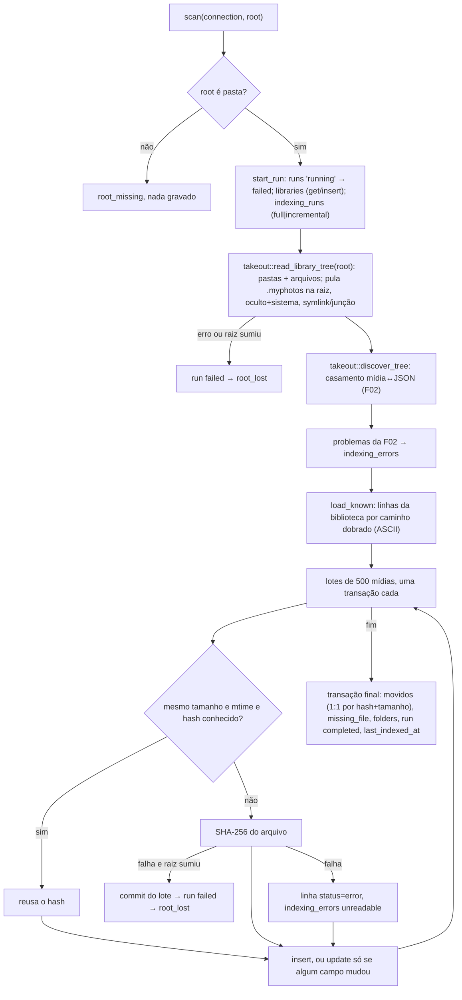

# F05 — File Scanner Design

**Spec**: `.specs/features/f05-file-scanner/spec.md`
**Status**: Approved (stakeholder "pode prosseguir", 2026-10-06)

---

## Architecture Overview

Uma chamada `scan(&mut Connection, root)` faz uma única caminhada do disco, reaproveita o matcher da F02 sobre a árvore lida, e grava em lotes. O que "sumiu" só é decidido no fim, numa transação, e só quando a caminhada foi completa.

### Abordagens consideradas

| Abordagem | Prós | Contras |
| --------- | ---- | ------- |
| **A. Uma caminhada compartilhada com a F02 (`read_library_tree` + `discover_tree`)** — escolhida | O `E:` (USB) é lido uma vez; as regras de AD-010 (system dirs, symlink, partes do export) ficam num só lugar | Refatora `takeout/mod.rs` (a API pública `discover` não muda) |
| B. Scanner com caminhada própria e `discover()` depois | Não toca na F02 | Duas caminhadas de 300k entradas; duas cópias das regras de pastas ignoradas |
| C. Matcher por pasta durante a caminhada | Memória menor | A F02 casa por pasta *lógica* (partes `-1-001`/`-1-002` do export); só dá depois de ver todas as partes |

---

## Code Reuse Analysis

| Component | Location | How to Use |
| --------- | -------- | ---------- |
| Caminhada e matcher | `src-tauri/src/takeout/mod.rs` | Dividido em `read_library_tree` (agora registra as pastas e pula `.myphotos` na raiz) e `discover_tree`; `discover`/`discover_with` continuam iguais por fora |
| `classify` / extensões de mídia | `src-tauri/src/takeout/classify.rs` | O que é mídia; o scanner deriva `media_type` e `extension` do nome |
| `hash_reader` + `to_hex` | `src-tauri/src/bench/hash.rs` | SHA-256 em blocos de 64 KiB; módulo passa a `pub(crate)` |
| `migrate` | `src-tauri/src/db/mod.rs` | `open_in_memory()` (só em teste) aplica as migrações num banco em memória |
| `Scratch` | `src-tauri/src/db/mod.rs` tests | Diretórios temporários dos testes; nunca `E:\` |

---

## Components

### `scan` (`src-tauri/src/scan/mod.rs`)

- `pub fn scan(connection: &mut Connection, root: &Path) -> Result<ScanSummary, ScanError>` — produção: lotes de 500, hash de arquivo real.
- `pub(crate) fn scan_with(connection, root, batch, hash: &mut dyn FnMut(&Path) -> io::Result<String>)` — seam de teste: tamanho do lote e leitor injetados (contar hashes, simular arquivo bloqueado, simular disco desconectado apagando a raiz no N-ésimo hash).
- `ScanSummary { run_id, run_type, files_scanned, files_indexed, files_errored, hashed, missing, moved }`.
- `ScanError`:

| Variant | `as_code()` | `message()` |
| ------- | ----------- | ----------- |
| `RootMissing` | `root_missing` | `pasta da biblioteca não encontrada` |
| `RootLost` | `root_lost` | `a pasta da biblioteca sumiu durante a varredura` |
| `DatabaseFailed` | `database_failed` | `falha ao gravar no banco` |

### Regras de gravação

| Situação | Ação |
| -------- | ---- |
| Caminho novo | `INSERT`, `files_indexed += 1`; guarda `(id, linha)` como candidata a "movida" |
| Caminho conhecido, mesmo tamanho e `fs_modified_at`, hash não nulo | Reusa o hash. `UPDATE … WHERE NOT (todos os campos IS iguais)` — só escreve (e muda `updated_at`) se o casamento, a caixa do caminho ou o status mudou |
| Caminho conhecido, tamanho ou mtime diferente, ou hash nulo | Recalcula o hash e atualiza com o mesmo `id` |
| `stat` ou hash falha, raiz ainda existe | Linha com `indexing_status='error'`, hash `NULL`, `indexing_error`; `indexing_errors` `unreadable` |
| `stat` ou hash falha, raiz sumiu | Commit do lote corrente (linhas inteiras), run `failed`, `root_lost`. Nada vira `missing_file` |
| Mesmo caminho dobrado duas vezes (só fora do NTFS) | Primeiro em ordem fica; o segundo vira `indexing_errors` `invalid_name` |
| Fim: linha conhecida não vista, fora de pasta ilegível | Se exatamente uma linha nova tem o mesmo SHA-256 e tamanho, e ela é a única ausente com esse conteúdo: apaga a nova e move a antiga para o caminho novo (`moved`). Senão `missing_file` (`missing`) |
| Fim: pastas | Upsert de cada pasta lida (corrige a caixa); apaga as que não foram vistas e não estão sob pasta ilegível |

A comparação do caminho no `UPDATE` e no upsert de pasta usa `COLLATE BINARY`: a coluna é `NOCASE`, e uma pasta renomeada só na caixa (`ferias` → `Ferias`) seria "igual" sem isso.

Datas: `fs_modified_at`/`fs_created_at` e os carimbos do app em ISO-8601 UTC com `Z`, segundos inteiros, formatados em Rust (`civil_from_days`) para comparar como texto com o que está no banco.

---

## Error Handling Strategy

| Error Scenario | Handling | User Impact |
| -------------- | -------- | ----------- |
| Raiz ausente antes de começar | `root_missing`, nenhuma linha | — (F10/F17 mostram) |
| Raiz some durante a caminhada ou o hash | run `failed`, lotes já gravados ficam, nada `missing_file` | Biblioteca não "esvazia" com o disco desconectado |
| Pasta ilegível | `unreadable_directory`; mídias e subpastas dela ficam como estavam | Nada some por permissão |
| Arquivo ilegível | linha `error` + `unreadable`; varredura continua | Volta a `ok` quando ficar legível |
| JSON inválido/ilegível/órfão | `invalid_json`/`unreadable`/`orphan_json` com o caminho do JSON; mídia `none` | F28 lista |
| Erro do SQLite | `database_failed`; run fica `running` e vira `failed` na próxima varredura | — |

---

## Tech Decisions

| Decision | Choice | Rationale |
| -------- | ------ | --------- |
| Onde o scanner mora | `src-tauri/src/scan/`, `#![allow(dead_code)]`, sem comando Tauri | Spec: sem gatilho no app nesta feature |
| Hash | Sequencial, em ordem de caminho | `E:` é USB e respondeu `unknown` no F03; F32 mede paralelismo |
| Banco dos testes | `db::open_in_memory()` (migrações reais, `foreign_keys=ON`) | Roda igual em Windows e Linux; a abertura em arquivo já é coberta pela F04 |
| Nova migração | Nenhuma | O esquema v1 já tem tudo; `indexing_errors.error_type` já aceita os tipos da F02 |
| Cópia de `.myphotos` em subpasta | É varrida normalmente | AD-011 fala da pasta na raiz |

## Risks

| Risk | Mitigation |
| ---- | ---------- |
| mtime com resolução de segundo: mudança no mesmo segundo e mesmo tamanho não é vista | Aceito pela spec; a próxima mudança de mtime pega |
| Memória: `load_known` e as candidatas a movida ficam em memória | ~300k linhas × ~150 bytes ≈ 45 MB no pior caso do roadmap; aceito para o MVP |
| `COLLATE NOCASE` só dobra ASCII (F04) | `fold()` também é ASCII, então scanner e banco concordam |
| Testes só-Windows (junção, oculto+sistema, `icacls`, nome UTF-16 inválido) não rodam na sessão na nuvem | Têm variante Unix onde dá; o gate é o CI `windows-latest` |
