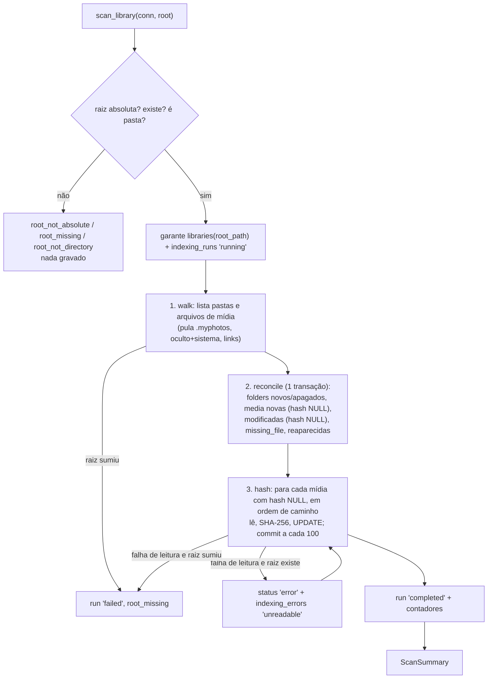

# F05 — File Scanner Design

**Spec**: `.specs/features/f05-file-scanner/spec.md`
**Status**: Approved (stakeholder "go ahead", 2026-10-05)

---

## Architecture Overview

Uma varredura tem três fases, sempre nesta ordem. A listagem só lê metadados; a reconciliação é uma transação; o hash lê o conteúdo um arquivo por vez e grava em lotes. Uma queda entre fases deixa o banco consistente porque "hash NULL" significa "ler de novo".

### Abordagens consideradas

| Abordagem | Prós | Contras |
| --------- | ---- | ------- |
| **A. Listar tudo, reconciliar numa transação, depois hashear em lotes** — escolhida | A listagem é rápida (F03: ~6 s para 150k no HDD); remoções só são decididas com a árvore completa; retomada natural por "hash NULL" | Duas passadas pelos dados em memória (barato: ~6 mil itens hoje) |
| B. Listar e hashear na mesma passada, gravando item a item | Uma passada | Uma transação por arquivo ou estado parcial difícil de retomar; remoção só no fim de qualquer forma |
| C. Reaproveitar `takeout::discover` como listagem | Sem código novo de walk | `discover` agrupa por pasta lógica e lê JSON; o F05 precisa de pastas físicas, tamanhos e datas e não deve ler JSON |

---

## Code Reuse Analysis

| Component | Location | How to Use |
| --------- | -------- | ---------- |
| `takeout::classify` + `MEDIA_EXTENSIONS` | `src-tauri/src/takeout/classify.rs` | "É mídia?" e a extensão em minúsculas. Passa a ser `pub(crate)` |
| `is_system_dir` (oculto+sistema) | `src-tauri/src/takeout/mod.rs` | Mesma regra de pular pastas. Passa a ser `pub(crate)` |
| `bench::hash::hash_reader` | `src-tauri/src/bench/hash.rs` | SHA-256 em blocos de 64 KiB. `to_hex` passa a ser `pub(crate)` |
| `db::open_library`, `db::close`, `db::MIGRATIONS` | `src-tauri/src/db/mod.rs` | `f05-scan` abre o banco real; os testes aplicam `MIGRATIONS` num banco temporário |
| Erro com `as_code()` + mensagem pt-BR | `db::DbError` | Mesmo formato para `ScanError` |
| `Scratch` | `db::tests::Scratch` | Diretório temporário com `Drop`; nunca `E:\` |
| Binário CLI | `src-tauri/src/bin/f03-bench.rs` | Mesmo estilo para `f05-scan` |

---

## Components

### `scan` — varredura

- **Location**: `src-tauri/src/scan/mod.rs` (fluxo e banco), `src-tauri/src/scan/walk.rs` (listagem), `src-tauri/src/scan/time.rs` (ISO-8601)
- **Interfaces**:
  - `pub const LIBRARY_ROOT: &str = r"E:\"`
  - `pub fn scan_library(connection: &mut Connection, root: &Path) -> Result<ScanSummary, ScanError>` — `scan_with(connection, root, &RealFs, &iso_utc(SystemTime::now()))`
  - `pub fn scan_default_library() -> Result<ScanSummary, &'static str>` — abre `db::open_library()`, varre `LIBRARY_ROOT`, fecha com `db::close`; devolve `DbError::as_code()` ou `ScanError::as_code()`
  - `pub(crate) fn scan_with(connection, root, fs: &dyn FileSystem, now: &str) -> Result<ScanSummary, ScanError>`
  - `pub(crate) trait FileSystem { fn list(&self, dir: &Path) -> io::Result<Vec<Entry>>; fn open(&self, file: &Path) -> io::Result<Box<dyn Read>>; }`
  - `pub(crate) struct Entry { name: Result<String, OsString>, kind: EntryKind, size: u64, modified: Option<SystemTime>, created: Option<SystemTime> }`, `enum EntryKind { Dir, File, Skip }` — `Skip` = link/junção ou pasta oculta+sistema
  - `RealFs`: `fs::read_dir` + `symlink_metadata` (não segue links) + `is_system_dir`; `open` = `File::open` (somente leitura)

### `ScanError`

| Variante | `as_code()` | `message()` |
| -------- | ----------- | ----------- |
| `RootNotAbsolute` | `root_not_absolute` | `pasta da biblioteca não é um caminho absoluto` |
| `RootMissing` | `root_missing` | `pasta da biblioteca não encontrada` |
| `RootNotDirectory` | `root_not_directory` | `a biblioteca não é uma pasta` |
| `DbWriteFailed` | `db_write_failed` | `falha ao gravar no banco` |

`RootMissing` também é o código quando a raiz some no meio (SCAN-06). Em `DbWriteFailed` a função tenta marcar a execução `failed`; se nem isso grava, a linha fica `running` (a F10 trata execuções órfãs).

### `ScanSummary` (JSON camelCase)

`runId`, `runType` (`full`/`incremental`), `folders`, `media` (encontradas no disco), `new`, `modified`, `unchanged`, `missing` (viraram `missing_file` nesta execução), `restored` (voltaram de `missing_file`), `hashed` (lidas com sucesso), `errors` (linhas em `indexing_errors` desta execução), `bytesHashed`.

`indexing_runs.files_scanned = media`, `files_indexed = hashed`, `files_errored = errors`.

### Regras de reconciliação (por mídia, chave = caminho com caixa ASCII dobrada, como `COLLATE NOCASE`)

| No disco | No banco | Ação | Conta |
| -------- | -------- | ---- | ----- |
| sim | não | INSERT, hash NULL, status `ok` | `new` |
| sim | sim, tamanho e mtime iguais, hash presente, status `ok` | nada | `unchanged` |
| sim | sim, tamanho e mtime iguais, hash presente, status `missing_file` | status `ok`, `updated_at` | `restored` |
| sim | sim, tamanho ou mtime diferentes | UPDATE tamanho, mtime, `fs_created_at`, hash NULL, `updated_at`; status `ok` | `modified` (+ `restored` se estava `missing_file`) |
| sim | sim, hash NULL (erro ou interrompida) | só entra na fila de hash | — |
| sim | sim, caminho difere só na caixa | UPDATE `relative_path` e `filename` para a caixa do disco, depois as regras acima | — |
| não | sim, status ≠ `missing_file`, fora de pasta ilegível | status `missing_file`, `updated_at` | `missing` |
| não | sim, dentro de pasta ilegível | nada | — |

Pastas: INSERT das novas; DELETE das que não estão no disco e não estão dentro de pasta ilegível. Pastas puladas e seu conteúdo nunca entram.

### Fila de hash

Todas as mídias vistas no disco com hash NULL depois da reconciliação, em ordem de `relative_path`. Sucesso: `file_hash_sha256`, `indexing_status = 'ok'`, `indexing_error = NULL`, `updated_at`. Falha: se a raiz ainda é pasta → `indexing_status = 'error'`, `indexing_error = 'unreadable'`, linha em `indexing_errors`; se não → para tudo com `root_missing`. Commit a cada 100 arquivos e no fim.

### Datas

`iso_utc(SystemTime) -> String` = `YYYY-MM-DDTHH:MM:SS.mmmZ` (algoritmo civil-from-days, sem dependência nova). Antes de 1970 → NULL. `created_at`/`updated_at`/`started_at`/`finished_at` usam o mesmo formato com o instante da varredura.

### `f05-scan`

`src-tauri/src/bin/f05-scan.rs`: chama `scan_default_library()`; sucesso → JSON indentado no stdout, código 0; erro → código no stderr, saída 1.

---

## Error Handling Strategy

| Error Scenario | Handling | User Impact |
| -------------- | -------- | ----------- |
| Raiz inválida/ausente | `ScanError` antes de qualquer gravação | Nada muda |
| Pasta ilegível | `unreadable_directory`; conteúdo conhecido protegido | Itens antigos continuam visíveis |
| Arquivo ilegível | `error` + `unreadable`; retentado depois | Item aparece sem hash |
| Nome inválido | `invalid_name`; pulado | Item não aparece |
| Raiz some | `root_missing`, run `failed`, nada marcado sumido pela desconexão | Reconectar e varrer de novo continua de onde parou |
| Falha no SQLite | `db_write_failed`, transação revertida | Próxima varredura refaz |

---

## Risks

| Risk | Mitigation |
| ---- | ---------- |
| Testes no Linux (nuvem) não exercitam atributos Windows | Regra oculto+sistema já testada no F02 (Windows); CI roda em `windows-latest` |
| Raiz de teste no Linux sem letra de unidade | `scan_with` só exige `Path::is_absolute()`; o banco de teste é aberto direto com `MIGRATIONS` (não por `db::open_with`, que exige letra) |
| `COLLATE NOCASE` só dobra ASCII | A chave em memória também dobra só ASCII |
| mtime com precisão diferente entre sistemas de arquivos | Comparação por string gravada pela mesma função; FAT/exFAT arredonda igual nas duas varreduras |
