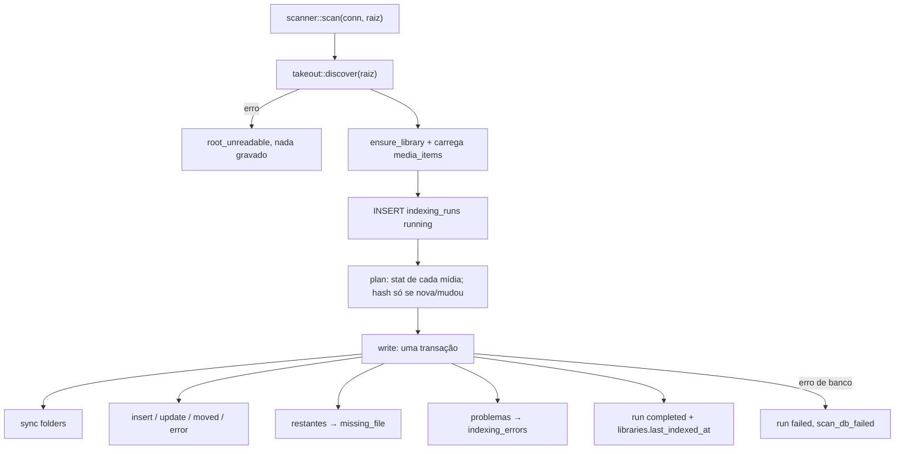

# F05 — File Scanner Design

**Spec**: `.specs/features/f05-file-scanner/spec.md`
**Status**: Approved (stakeholder "confirm, continue", 2026-10-11)

## Architecture Overview

## Code Reuse

| Component | Location | How |
| --------- | -------- | --- |
| `takeout::discover` | `src-tauri/src/takeout/mod.rs` | Lista mídias com o JSON casado e os problemas. Ganha `DiscoveryReport.folders` e pula `.myphotos` na raiz |
| `bench::hash::{hash_reader, to_hex}` | `src-tauri/src/bench/hash.rs` | SHA-256 em blocos de 64 KiB, já medido na F03. Módulo passa a `pub(crate)` |
| `db::open_unchecked` (teste) | `src-tauri/src/db/mod.rs` | Banco migrado em qualquer caminho, para os testes rodarem fora do Windows |

## Components

### `scanner` — `src-tauri/src/scanner/mod.rs`

- `pub fn scan(&mut Connection, &Path) -> Result<ScanSummary, ScanError>`
- `pub(crate) fn scan_with(.., hash: impl Fn(&Path) -> io::Result<[u8; 32]>)` — injeta falha de leitura e conta chamadas nos testes
- `ScanSummary { run_id, library_id, run_type, files_scanned, added, modified, moved, unchanged, missing, errored, folders }`
- `ScanError`: `RootUnreadable` (`root_unreadable`, `não foi possível ler a pasta da biblioteca`), `Database` (`scan_db_failed`, `falha ao gravar a varredura no banco`)

### `scanner::time` — `src-tauri/src/scanner/time.rs`

- `iso_utc(segundos) -> "AAAA-MM-DDTHH:MM:SSZ"` sem dependência nova (algoritmo de Howard Hinnant)

## Decisões de dados

| Coluna | Valor |
| ------ | ----- |
| `relative_path` | Como a F02 reporta (`/`, com a parte do Takeout). Comparação sem caixa (NOCASE) |
| `file_hash_sha256` | Hex minúsculo |
| `json_match_confidence` | `exact` / `heuristic` / `none` (sempre preenchido) |
| `indexing_runs.files_indexed` | `added + modified + moved` |
| `indexing_runs.files_errored` | Mídias que não puderam ser lidas (problemas da F02 não contam) |

## Risks

| Risk | Mitigation |
| ---- | ---------- |
| `mtime` com resolução de segundos não percebe edição no mesmo segundo com mesmo tamanho | Raro para fotos; F10 pode oferecer "reverificar tudo" |
| Transação única longa | Hash fica fora dela; só as escritas entram (~4 mil linhas) |
| Testes do F04 são só Windows | Testes da F05 usam `open_unchecked` e rodam em qualquer SO |
