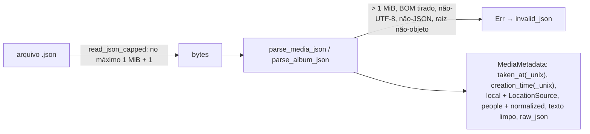

# F06 — Takeout JSON Parser Design

**Spec**: `.specs/features/f06-takeout-json-parser/spec.md`
**Status**: Approved (stakeholder "continue", 2026-10-06)

---

## Architecture Overview

Nada de módulo novo: o F06 endurece `takeout::parse` e amplia os modelos. `discover` passa a ler sidecars por um leitor limitado. A formatação ISO sai de `scan::time` para um módulo do crate, usado pelo scanner e pelo parser.



### Abordagens consideradas

| Abordagem | Prós | Contras |
| --------- | ---- | ------- |
| **A. Ampliar `MediaMetadata`/`AlbumMetadata` e o `parse.rs` do F02** — escolhida | Um só parser; `discover` já devolve o valor novo; testes TD continuam valendo | Muda a regra de texto/pessoas do F02 (só espaços nas pontas e duplicados) |
| B. Struct nova `NormalizedSidecar` derivada de `MediaMetadata` | F02 intocado | A fonte do local já se perdeu em `MediaMetadata`; dois tipos para a mesma coisa |
| C. Desserializar com `#[derive(Deserialize)]` tipado | Menos código de `Value` | Um campo com tipo errado derruba o sidecar inteiro, contra a tolerância do F02 |

---

## Code Reuse Analysis

| Component | Location | How to Use |
| --------- | -------- | ---------- |
| `parse_media_json`, `parse_album_json`, `read_point`, `parse_timestamp`, `read_text`, `read_people` | `src-tauri/src/takeout/parse.rs` | Endurecidos no lugar |
| `iso_utc` / `civil_from_days` | `src-tauri/src/scan/time.rs` | Movido para `src-tauri/src/time.rs`; ganha `iso_from_unix_seconds(i64)` com instantes negativos |
| `discover_with(root, read_json)` | `src-tauri/src/takeout/mod.rs` | `discover` passa `read_json_capped` em vez de `fs::read` |

---

## Components

### `time` (crate)

- **Location**: `src-tauri/src/time.rs` (antes `scan/time.rs`)
- `pub(crate) fn iso_utc(SystemTime) -> Option<String>` — inalterada
- `pub(crate) fn iso_from_unix_seconds(seconds: i64) -> Option<String>` — `YYYY-MM-DDTHH:MM:SS.000Z`; `None` fora de `[-5364662400, 253402300799]` (anos 1800–9999)

### `takeout::model`

```rust
pub enum LocationSource { GeoData, GeoDataExif }   // as_column(): "takeout_geoData" | "takeout_geoDataExif"

pub struct MediaMetadata {
    pub taken_at_unix: Option<i64>,      // F02
    pub taken_at: Option<String>,        // F06: ISO
    pub creation_time_unix: Option<i64>, // F02
    pub creation_time: Option<String>,   // F06: ISO
    pub latitude: Option<f64>, pub longitude: Option<f64>, pub altitude: Option<f64>, // F02
    pub location_source: Option<LocationSource>, // F06
    pub people: Vec<String>,             // F02, agora limpo e sem repetidos
    pub title: Option<String>, pub description: Option<String>, pub url: Option<String>,
    pub raw_json: String,                // F06
}

pub struct AlbumMetadata { /* F02 */ ..., pub date: Option<String> /* F06 */ }

pub fn normalized_person_name(display: &str) -> String  // minúsculas Unicode do nome já limpo
```

### `takeout::parse`

- `pub const MAX_SIDECAR_BYTES: usize = 1_048_576`
- `fn decode(bytes) -> Result<(&str, Map), ()>`: tamanho > teto → Err; tira `EF BB BF`; `str::from_utf8`; `serde_json::from_str::<Value>`; raiz `Object` ou Err
- `read_point`: os dois números, faixa, não `0/0`; altitude se for número (o `serde_json` não produz NaN/infinito — número fora do `f64` já é JSON inválido)
- `parse_timestamp`: regra do F02 + `0` → None + faixa via `iso_from_unix_seconds`
- `clean_name`: `split_whitespace().join(" ")`; vazio → None
- `read_people`: `clean_name`, dedup por `normalized_person_name`, ordem preservada
- `read_text`: `trim()`; vazio → None

### `takeout::read_json_capped(path) -> Result<Vec<u8>, String>`

`File::open(path)?.take(MAX_SIDECAR_BYTES as u64 + 1).read_to_end(...)`. Um arquivo maior volta com 1 MiB + 1 byte e o parser o recusa (`invalid_json`); erro de abertura/leitura continua `unreadable`.

---

## Error Handling Strategy

| Error Scenario | Handling | User Impact |
| -------------- | -------- | ----------- |
| Sidecar > 1 MiB | Lê 1 MiB + 1, parser recusa → `invalid_json` | Mídia sem par; F09 cai para EXIF |
| BOM | Ignorado | Nenhum |
| Raiz não-objeto / não-JSON / não-UTF-8 | `invalid_json` | Mídia sem par |
| Coordenada/instante absurdo | Campo ausente; resto do sidecar vale | Sem local ou sem data dessa fonte |

---

## Risks

| Risk | Mitigation |
| ---- | ---------- |
| Mudar a regra de texto/pessoas altera saídas do F02 | Testes TD ajustados explicitamente e listados no relatório |
| Mover `time.rs` quebra a F05 | Só o caminho do `use` muda; a suíte `scan::` roda no mesmo gate |
| `0` como "sem data" esconder uma data real | Instante exato 1970-01-01T00:00:00Z; nenhuma câmera grava isso de propósito |
