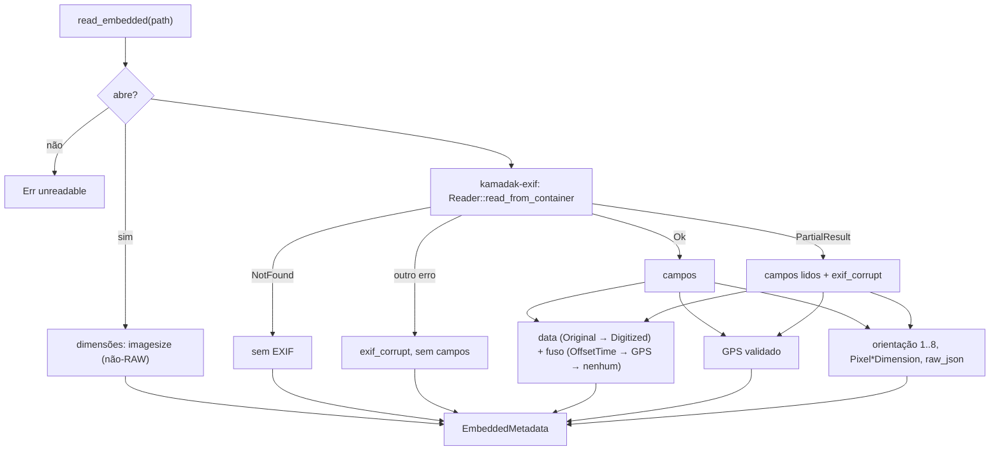

# F07 — EXIF Parser Design

**Spec**: `.specs/features/f07-exif-parser/spec.md`
**Status**: Approved (stakeholder "continue with defaults", 2026-10-06)

---

## Architecture Overview

Uma função de leitura por foto, sem estado. O arquivo é aberto só para leitura duas vezes no pior caso (cabeçalho de dimensões e contêiner EXIF). O cabeçalho para no começo do arquivo; o `kamadak-exif` pode ler o arquivo inteiro (TIFF/RAW, JPEG sem EXIF) — ver Risks.



### Abordagens consideradas

| Abordagem | Prós | Contras |
| --------- | ---- | ------- |
| **A. `kamadak-exif` + `imagesize`** — escolhida | Rust puro; cobre todos os formatos de foto do MVP; leitura parcial do arquivo | Duas dependências novas |
| B. `rexiv2`/`libexif` (C) | Muito completos (XMP/IPTC) | Biblioteca nativa no build Windows; o `C:` tem pouco espaço |
| C. `exiftool` como processo | O mais completo | Perl/binário externo, lento por arquivo, distribuição |
| D. Parser TIFF/EXIF próprio | Zero dependência | Semanas de casos de borda (HEIF, endianness, offsets) |

---

## Code Reuse Analysis

| Component | Location | How to Use |
| --------- | -------- | ---------- |
| `iso_from_unix_seconds`, `civil_from_days` | `src-tauri/src/time.rs` | Ganha `days_from_civil` (inverso) para converter hora local + fuso em UTC; formato ISO igual ao F05/F06 |
| Validação de ponto (faixa, `0/0`) | `src-tauri/src/takeout/parse.rs` (`read_point`) | Mesma regra, reimplementada sobre números já convertidos (o F06 lê de `serde_json::Value`) |
| `Scratch` | `db::tests::Scratch` | Arquivos temporários nos testes |

---

## Components

### `photo_meta` (o nome `exif` colidiria com o crate `exif`)

- **Location**: `src-tauri/src/photo_meta/mod.rs` (leitura e montagem), `src-tauri/src/photo_meta/date.rs` (data, subsegundo, fuso), `src-tauri/src/photo_meta/tests.rs` (fixtures geradas)
- **Interfaces**:

```rust
pub enum DateTag { Original, Digitized }          // as_tag(): "DateTimeOriginal" | "DateTimeDigitized"

pub struct EmbeddedMetadata {
    pub taken_at_local: Option<String>,   // "2022-08-10T11:37:00.500"
    pub taken_at_offset: Option<String>,  // "-03:00"
    pub taken_at: Option<String>,         // "2022-08-10T14:37:00.500Z"
    pub taken_at_tag: Option<DateTag>,
    pub latitude: Option<f64>, pub longitude: Option<f64>, pub altitude: Option<f64>,
    pub width: Option<u32>, pub height: Option<u32>,
    pub orientation: Option<u16>,
    pub raw_json: Option<String>,
    pub exif_corrupt: bool,
}

pub enum EmbeddedError { Unreadable }     // as_code(): "unreadable"

pub fn read_embedded(path: &Path) -> Result<EmbeddedMetadata, EmbeddedError>
```

- RAW = extensão `dng cr2 nef arw` (sem diferenciar caixa).

### Data e fuso (`date.rs`)

- `parse_exif_datetime(&[u8]) -> Option<LocalDateTime>`: 19 bytes `AAAA?MM?DD HH:MM:SS` com `?` ∈ {`:`, `-`}; calendário real (bissexto); hora < 24, min/seg < 60; ano 1800–9999
- `parse_subsec(&[u8]) -> u32`: 3 primeiros dígitos, completados com zero; lixo → 0
- `parse_offset(&[u8]) -> Option<i32>` (minutos): `[+-]HH:MM`, HH ≤ 14, MM < 60, total ≤ 14 h
- `gps_offset(local, gps_date, gps_time) -> Option<i32>`: `round((local − utc) / 15 min) × 15`, aceito se |·| ≤ 14 h
- `to_utc(local, offset_minutes) -> Option<String>`: segundos locais − offset → `iso_from_unix_seconds` + milissegundos

### `time.rs`

- `pub(crate) fn days_from_civil(year, month, day) -> i64` (Hinnant) e `pub(crate) fn iso_from_unix_millis(i64 seconds, u32 millis) -> Option<String>` (mesma faixa 1800–9999)

---

## Error Handling Strategy

| Error Scenario | Handling | User Impact |
| -------------- | -------- | ----------- |
| Arquivo não abre | `Err(Unreadable)` | F10 registra `unreadable` |
| Sem EXIF | `Ok`, campos ausentes | Nenhum; F09 cai para o sistema de arquivos |
| EXIF lixo | `Ok`, `exif_corrupt` | F10 pode registrar `corrupt_media` |
| EXIF parcial | Campos lidos valem, `exif_corrupt` | Dados possíveis aproveitados |
| Cabeçalho ilegível | Dimensões do EXIF ou ausentes | Grade usa proporção padrão |

---

## Risks

| Risk | Mitigation |
| ---- | ---------- |
| HEIC real não testado (gerar HEIC no teste é inviável) | Coberto pelo crate; tamanho de HEIF vem do EXIF (o `imagesize` aplica `irot`); validar na varredura real (F10) |
| WebP cujo chunk EXIF começa com `Exif\0\0` (alguns gravadores) | O crate o vê como EXIF corrompido: `exif_corrupt` e sem campos. Registrado; medir na varredura real antes de contornar |
| Leitura completa: TIFF/RAW é lido inteiro e JPEG sem EXIF é percorrido até o fim (comportamento do crate) | O F05 já lê cada arquivo inteiro para o hash; custo de I/O igual. Otimização (ler junto com o hash) fica para F10/F32 |
| `imagesize` em RAW devolver a miniatura | RAW nunca usa `imagesize` |
| GPS com hora de fix antiga desvia o fuso | Arredondamento a 15 min absorve até ±7 min; acima disso o fuso pode errar e fica registrado como derivado do GPS (a fonte é reportável depois) |
